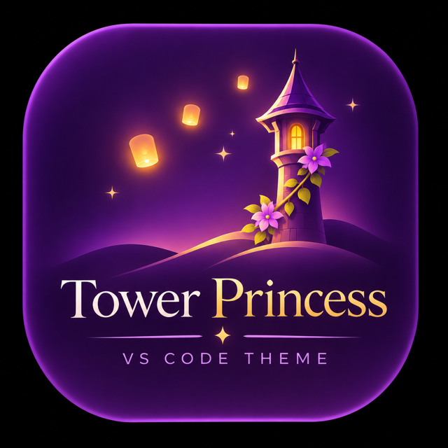
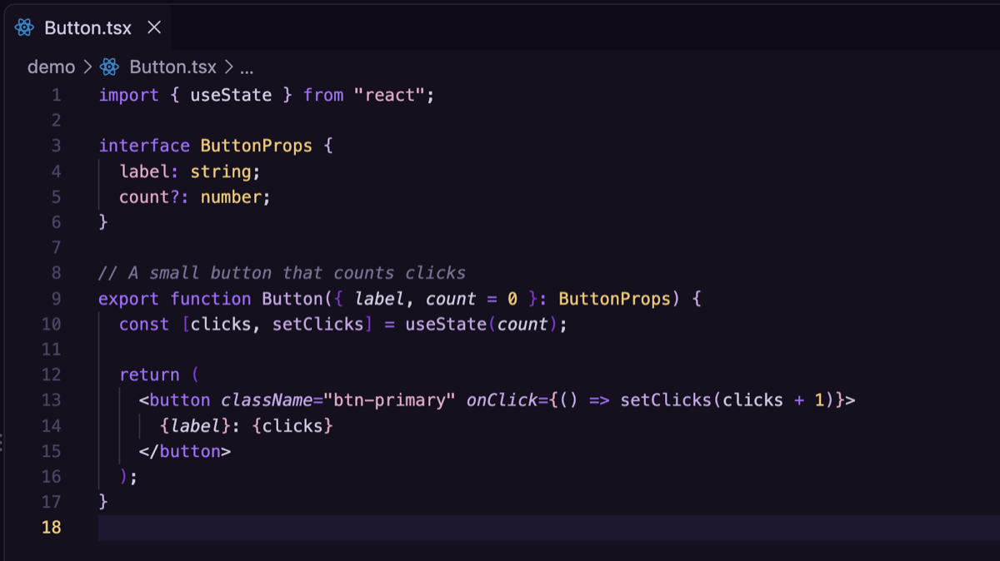
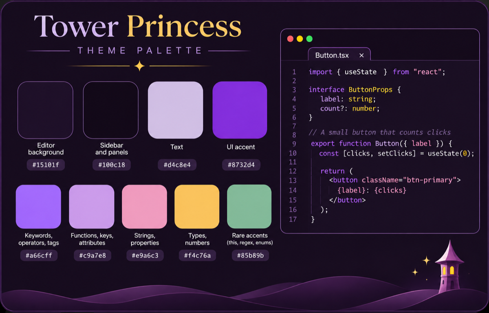

<p align="center">
  
</p>

# Tower Princess

A dark VS Code theme with midnight purples, lavender and lantern gold.



## Palette



|  | Role | Color |
| --- | --- | --- |
|  | Editor background | `#15101f` |
|  | Sidebar and panels | `#100c18` |
|  | Text | `#d4c8e4` |
|  | UI accent | `#8732d4` |
|  | Keywords, operators, tags | `#a66cff` |
|  | Functions, keys, attributes | `#c9a7e8` |
|  | Strings, properties | `#e9a6c3` |
|  | Types, numbers | `#f4c76a` |
|  | Rare accents (this, regex, enum members) | `#85b89b` |

## Install

Search for **Tower Princess** in the Extensions view, or run:

```
code --install-extension thaisemanuele.tower-princess
```
